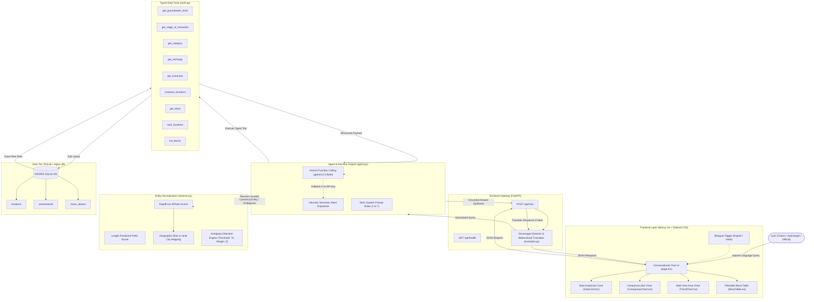
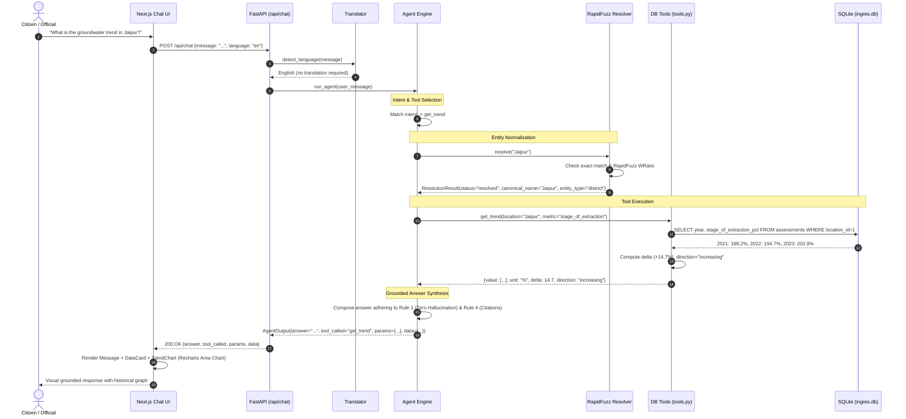
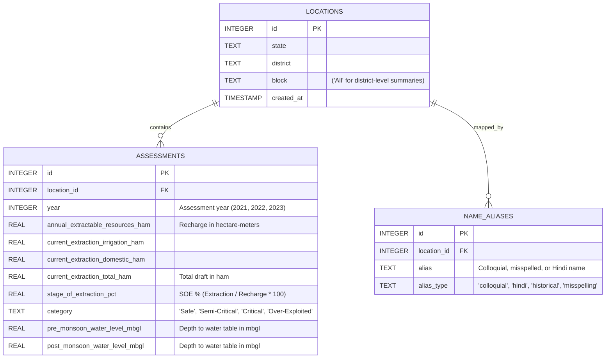
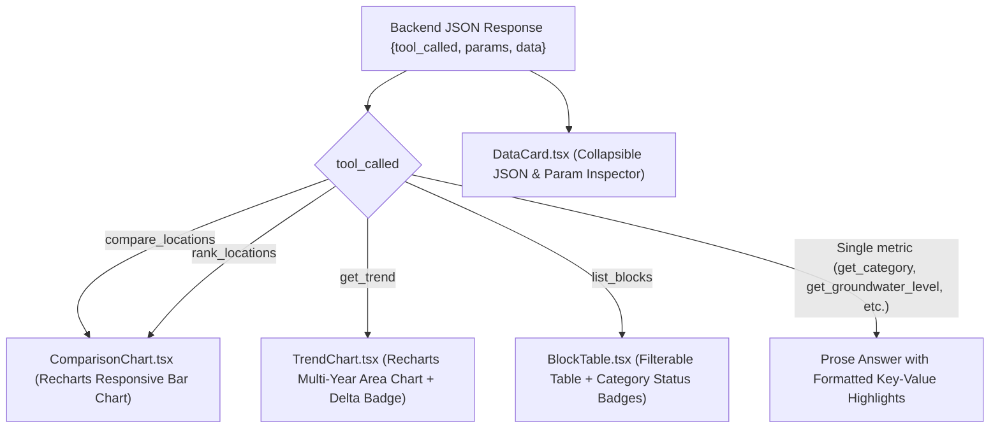

# INGRES-Agent: System Architecture & Technical Specifications
**Smart India Hackathon Problem SIH25066**
*Authoritative Conversational AI for CGWB / IIT Hyderabad INGRES Open Data*

---

## 1. High-Level Architecture Overview

INGRES-Agent is designed around a **grounded tool-calling architecture** that decouples conversational comprehension from factual data retrieval. Language models alone frequently hallucinate critical hydrological metrics; INGRES-Agent eliminates numerical hallucination by guaranteeing that every quantitative statistic returned to the user originates directly from verified CGWB assessment records in SQLite.

---

## 2. End-to-End Query Execution Sequence

The diagram below details the sequence of events from when a citizen submits a natural query (e.g. in Hindi or English) to the rendering of interactive visualization widgets.

---

## 3. Core Subsystems

### 3.1. Entity Resolution Pipeline ([resolver.py](file:///Users/khushimadan/GroundWater/ingres-agent/backend/app/resolver.py))

User inputs regularly contain spelling variations, colloquial terms, or Devanagari transliterations. The resolver operates a tiered matching pipeline:

1. **Query Sanitization**: Strips administrative affixes (`district`, `block`, `tehsil`, `city`) and punctuation.
2. **Alias Lookup**: Direct mapping for historical and Devanagari city names (`Poona` $\rightarrow$ `Pune`, `Banaras`/`Kashi` $\rightarrow$ `Varanasi`, `जयपुर` $\rightarrow$ `Jaipur`).
3. **Exact Database Match**: Scans state, district, and block corpora for verbatim matches.
4. **Length-Penalized RapidFuzz WRatio**: Scans eligible entities with token sort and ratio scorers. Disparities where $(|len_1 - len_2| / \max(len_1, len_2)) > 0.5$ are penalized.
5. **Short Prefix Scorer**: Inputs with length $\ge 3$ matching candidate prefixes receive a calibrated `80.0` score.
6. **Ambiguity Gate**:
   - If multiple candidates fall within the ambiguity margin ($\Delta score \le 5.0$), or if an un-aliased query of length $\le 3$ matches candidates, the status is flagged as `ambiguous`.
   - The agent interrupts tool execution (`tool_called=None`) and prompts the user with candidate options (e.g. `Nagpur` vs `Nagpur Rural`).

---

### 3.2. Strict Anti-Hallucination Guardrails ([agent.py](file:///Users/khushimadan/GroundWater/ingres-agent/backend/app/agent.py))

To ensure complete adherence to Smart India Hackathon reliability guidelines, the agent strictly enforces seven system instructions:

| Rule # | Guardrail Name | Enforcement Mechanism |
|---|---|---|
| **Rule 1** | **Zero Numerical Hallucination** | No statistical digits may appear in prose unless passed in `tool_data`. |
| **Rule 2** | **Omitted Year Defaulting** | If the user omits the assessment year, the agent defaults to `2023` and prepends: *"Defaulting to the latest available assessment year (2023)."* |
| **Rule 3** | **Refusal on Missing Data** | If the requested entity is unmonitored or missing from CGWB data, returns: *"Data not available for the requested query."* |
| **Rule 4** | **Mandatory Citations** | Every answer must explicitly list: **Value**, **Unit**, **Year**, **Location**, and **Source** (`INGRES (ingres.iith.ac.in) / CGWB Open Data`). |
| **Rule 5** | **Tool Scope Separation** | Strict boundary separating block inventory (`list_blocks`) from single-block categorization (`get_category`), and ranking (`rank_locations`) from comparison (`compare_locations`). |
| **Rule 6** | **Disambiguation Solicitation** | Ambiguous entities pause tool execution and return structured candidate options. |
| **Rule 7** | **Out-of-Scope Shield** | Non-groundwater queries (sports, coding, recipes) are politely deflected with guidance back to hydrological topics. |

---

### 3.3. Database Schema ([ingres.db](file:///Users/khushimadan/GroundWater/ingres-agent/backend/data/ingres.db))

The database schema is normalized into three relational tables in SQLite:

---

### 3.4. Generative UI Component Architecture ([frontend](file:///Users/khushimadan/GroundWater/ingres-agent/frontend))

The Next.js 16 frontend inspects the returned `tool_called` and `data` payload to dynamically render interactive visual components under each conversational answer:

- **[DataCard.tsx](file:///Users/khushimadan/GroundWater/ingres-agent/frontend/src/components/DataCard.tsx)**: Provides auditability for judges and researchers by revealing the exact Python tool executed, resolved arguments, and raw database record.
- **[ComparisonChart.tsx](file:///Users/khushimadan/GroundWater/ingres-agent/frontend/src/components/ComparisonChart.tsx)**: Displays comparative bar visualisations with tooltip hover states and a toggleable data table.
- **[TrendChart.tsx](file:///Users/khushimadan/GroundWater/ingres-agent/frontend/src/components/TrendChart.tsx)**: Displays historical curves with positive/negative net change badges and year-by-year points.
- **[BlockTable.tsx](file:///Users/khushimadan/GroundWater/ingres-agent/frontend/src/components/BlockTable.tsx)**: Supports block-level exploration with search filtering and color-coded status pills (`Over-Exploited` in red, `Critical` in amber, `Safe` in green).
